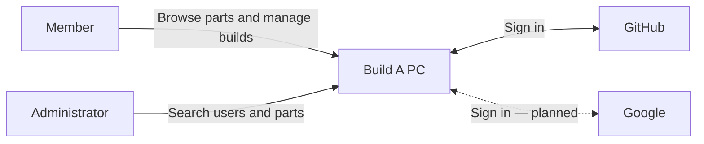
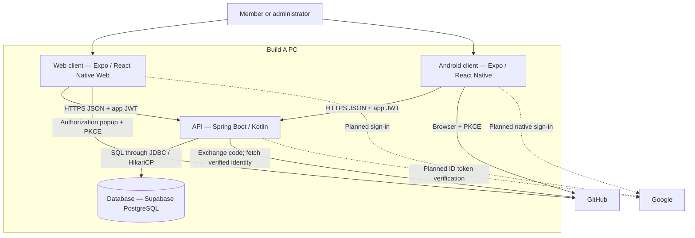

# Architecture

## Context — C4 level 1

Members browse parts and manage PC builds. Administrators search users and parts.
GitHub sign-in works; Google sign-in is required but still planned.

## Containers — C4 level 2

Web and Android share Expo screens, session handling, and API client code. Supabase
hosts PostgreSQL; it is not the authentication provider. Render is the intended API
host; production deployment has not been verified here.

The API issues a one-hour app JWT and enforces ownership and current database admin
roles. Android stores the token in SecureStore; web uses sessionStorage. Provider
secrets stay on the API. Local development uses HTTP; production must use HTTPS.

See [OAuth sequence](auth-sequence.md), [data model](erd.md),
[API contract](openapi.yaml), [security](security.md), and [decisions](adr/).
