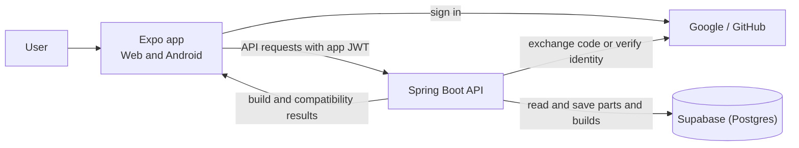

# Build A PC Architecture

The Expo app runs on web and Android and uses the Spring Boot API for app features and sign-in.
The API runs on Render, connects to Supabase Postgres, and returns build and compatibility data
to the app.
