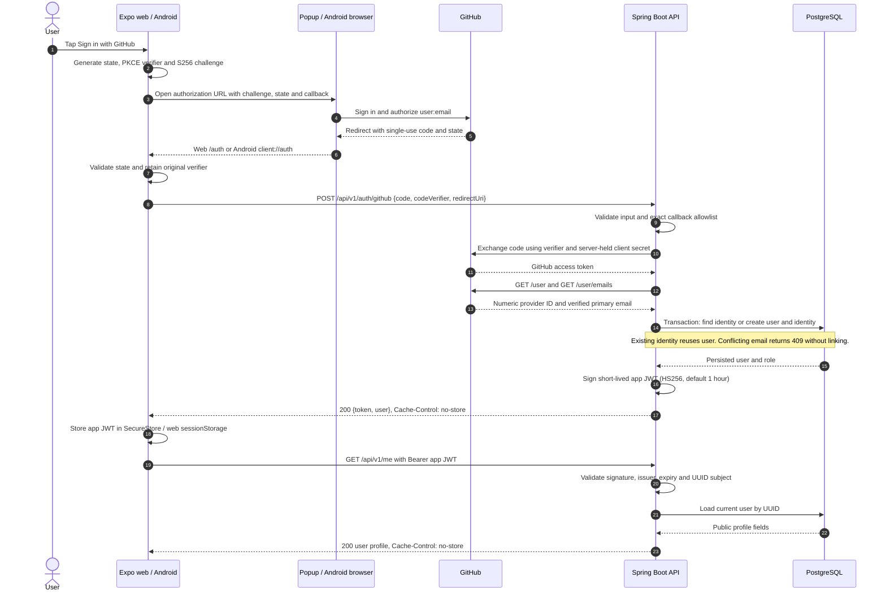

# OAuth sequences

GitHub and Google have web and Android login implementations. Spring Boot issues
the app JWT; Supabase hosts PostgreSQL only. Real Google Android sign-in still needs
registration and device verification.

## GitHub — web and Android



- Client secrets and GitHub access tokens stay on the API. The client receives
  only the app JWT; browser callbacks carry the code and state, not tokens.
- Invalid input/code/verifier, an unapproved callback, or no verified primary email
  returns 400. An existing email under another provider returns 409 naming it;
  unusable GitHub responses return 502. Rejected identities create no account.
- App startup restores the saved JWT through `/me`. Invalid/expired tokens or
  unavailable accounts return 401 and clear the saved session. Network failures
  preserve the token and allow retry.
- Cancellation makes no exchange request. Android callbacks without a pending
  request offer a fresh sign-in; interrupted sign-ins are not resumed after app death.
- Logout removes local token/profile state. It does not revoke GitHub authorization
  or an already issued JWT. Refresh tokens and account linking are not implemented.

## Google — web

```mermaid
sequenceDiagram
    autonumber
    actor User
    participant Web as Expo web
    participant Google
    participant API as Spring Boot API
    participant DB as PostgreSQL

    User->>Web: Click Sign in with Google
    Web->>Web: Prepare state and S256 PKCE challenge
    Web->>Google: Open popup with openid email profile and /auth callback
    Google-->>Web: Redirect popup to /auth with code and state
    Web->>Web: Complete popup; validate state
    Web->>API: POST /api/v1/auth/google {code, code_verifier, redirect_uri}
    API->>API: Validate input and exact configured callback
    API->>Google: Exchange code with verifier and server-held web credentials
    Google-->>API: ID token
    API->>Google: Retrieve signing keys when needed
    API->>API: Verify signature, issuer, audience, expiry and verified email
    API->>DB: Find identity or create USER account and GOOGLE identity
    Note over API,DB: Existing email under another provider returns 409; no linking
    DB-->>API: Persisted application user
    API-->>Web: 200 {token, user}, Cache-Control: no-store
    Web->>Web: Store app JWT in sessionStorage
    Web->>API: GET /api/v1/me with Bearer app JWT
    API-->>Web: Current application profile
```

Google's `sub` identifies the provider account. Missing configuration returns 503;
rejected codes, invalid tokens, and unverified emails return 400; upstream failures
return 502. Restoration and logout use the shared session behavior above.

## Google ? Android

```mermaid
sequenceDiagram
    autonumber
    actor User
    participant App as Expo Android
    participant SDK as Native Google Sign-In
    participant Google
    participant API as Spring Boot API
    participant DB as PostgreSQL
    User->>App: Tap Sign in with Google
    App->>SDK: Check Play Services; signIn using Web client ID
    SDK->>Google: Native account selection and authorization
    Google-->>SDK: ID token with Web client audience
    SDK-->>App: ID token (or cancellation)
    App->>API: POST /api/v1/auth/google {idToken}
    API->>Google: Retrieve signing keys when needed
    API->>API: Verify signature, issuer, audience, expiry, subject and verified email
    API->>DB: Find or create GOOGLE identity and user
    Note over API,DB: Conflicting provider email returns 409; no linking
    API-->>App: 200 {token, user}, Cache-Control no-store
    App->>App: Save only app JWT in SecureStore
    App->>API: GET /api/v1/me with Bearer app JWT
    API-->>App: Current profile
    User->>App: Log out
    App->>App: Remove saved app JWT and profile
    App->>SDK: signOut (serialized after any pending sign-in)
```

Cancellation sends no API request. Late results cannot restore a logged-out session.
Google tokens are transient. Logout clears the native SDK session without revoking
Google consent or existing app JWTs; failed SDK cleanup permits retry.
