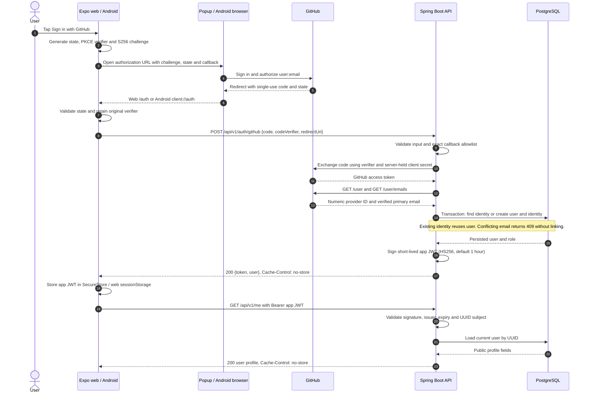

# GitHub OAuth sequence

Implemented for Expo web and Android. Spring Boot exchanges the code and issues
the app JWT; Supabase hosts PostgreSQL only, not authentication endpoints.

- Client secrets and GitHub access tokens stay on the API. The client receives
  only the app JWT; browser callbacks carry the code and state, not tokens.
- Invalid input/code/verifier, an unapproved callback, or no verified primary email
  returns 400. An existing email under another provider returns 409 naming it;
  unusable GitHub responses return 502. Rejected identities create no account.
- App startup restores the saved JWT through `/me`. Invalid/expired tokens or
  unavailable accounts return 401 and clear the saved session. Network failures
  preserve the token and allow retry.
- Cancellation makes no exchange request. Android callbacks without a pending
  request offer a fresh sign-in; interrupted sign-ins are not resumed after app death.
- Logout removes local token/profile state. It does not revoke GitHub authorization
  or an already issued JWT. Refresh tokens and account linking are not implemented.

Google remains planned and is not represented as an implemented flow here.
