# Database schema

This document reflects the team's latest Supabase `public` schema dump, committed
as `api/src/main/resources/db/migration/V1__initial_schema.sql`. It supersedes the
earlier context-only export. This is a description of that snapshot, not a live
database inspection. The SQL file initializes fresh local/test databases; Flyway
is not used and the file must not be replayed against the existing hosted schema.

## Constraints, defaults, and nullable fields

- All 30 tables are in `public`. Every primary key is non-null. The five core
  tables use UUID `id` keys defaulting to `gen_random_uuid()`; each category detail
  table uses `part_id` as both its primary key and a foreign key to `catalog_parts`.
- `users`: `email` is non-null and unique; `display_name` is nullable; `role` is
  non-null and defaults to `USER`; `created_at` is non-null and defaults to `now()`.
- `identities`: `user_id`, `provider`, and `provider_user_id` are non-null;
  `created_at` is non-null and defaults to `now()`. The pair
  `(provider, provider_user_id)` is unique.
- `pc_builds`: `user_id` and `name` are non-null; `created_at` is non-null and
  defaults to `now()`.
- `catalog_parts`: `category` and `name` are non-null; `price` is nullable
  `numeric(10,2)`; `created_at` is non-null and defaults to `now()`.
- `build_parts`: `build_id` and `catalog_part_id` are non-null and their pair is
  unique; `quantity` is non-null, defaults to `1`, and must be greater than zero.
- Every non-key column in the category detail tables is nullable.
  `memory_details.price_per_gb` and `internal_hard_drive_details.price_per_gb`
  use `numeric(10,3)`; other detail-table numeric fields have no declared precision.
- `provider` and `role` are plain text without declared value checks. Application
  values such as `GITHUB`/`GOOGLE` and `USER`/`ADMIN` are not database-enforced enums.
- Row-level security is enabled on all 30 tables; the dump defines no policies.
  Table owners normally bypass RLS. A restricted API database role needs an
  appropriate access policy; RLS does not replace API authorization checks.

### Foreign-key deletion behavior

- Deleting a user cascades to their identities and PC builds; deleting a build
  cascades to its selected `build_parts`. Account deletion endpoints are not yet
  implemented.
- Deleting a catalog part cascades to its `case_details`, `cpu_cooler_details`,
  `cpu_details`, `internal_hard_drive_details`, `memory_details`,
  `motherboard_details`, `power_supply_details`, and `video_card_details` rows.
- All remaining foreign keys use the default `NO ACTION`. In particular, build
  selections and the other category detail rows can block catalog-part deletion.

There are explicit indexes on `build_parts.build_id`,
`build_parts.catalog_part_id`, `catalog_parts.category`, and `pc_builds.user_id`,
in addition to indexes backing primary keys and unique constraints.

`catalog_parts.category` is restricted to these exact values:

```text
case-accessory, case-fan, case, cpu-cooler, cpu, external-hard-drive,
fan-controller, headphones, internal-hard-drive, keyboard, memory, monitor,
motherboard, mouse, optical-drive, os, power-supply, sound-card, speakers,
thermal-paste, ups, video-card, webcam, wired-network-card, wireless-network-card
```

## GitHub OAuth persistence mapping

- `User` and `Identity` map the existing `public` tables; repositories provide
  email lookup, provider identity lookup (with its user), and identities by user ID.
- Application inserts generate UUIDs through JPA and supply creation timestamps;
  new users default to `USER`. Database defaults remain available for SQL inserts
  that omit those columns. IDs are null until JPA persists the entities.
- The identity's user association is lazy by default and has no JPA removal cascade
  toward the user. Deletion from user to identities is enforced by the database.
- Existing identity uniqueness and deletion constraints meet the auth appendix;
  no schema changes are needed for these mappings.
- Verified-email decisions, transactional account creation, OAuth exchange, JWTs,
  and endpoints remain later work. The entities alone do not implement those rules.
- The current Kotlin catalog entity still makes `price` non-null and omits
  `created_at`. Sample endpoint categories `CPU` and `Memory` differ from lowercase
  database values. Persisted catalog access remains outside this account chunk.

## Entity relationship diagram

```mermaid
erDiagram
    USERS {
        uuid id PK
        text email UK
        text display_name
        text role
        timestamptz created_at
    }

    IDENTITIES {
        uuid id PK
        uuid user_id FK
        text provider
        text provider_user_id
        timestamptz created_at
    }

    PC_BUILDS {
        uuid id PK
        uuid user_id FK
        text name
        timestamptz created_at
    }

    CATALOG_PARTS {
        uuid id PK
        text category
        text name
        numeric price
        timestamptz created_at
    }

    BUILD_PARTS {
        uuid id PK
        uuid build_id FK
        uuid catalog_part_id FK
        integer quantity
    }

    CPU_DETAILS {
        uuid part_id PK, FK
        integer core_count
        numeric core_clock
        numeric boost_clock
        text microarchitecture
        integer tdp
        text graphics
    }

    CPU_COOLER_DETAILS {
        uuid part_id PK, FK
        jsonb rpm
        jsonb noise_level
        text color
        numeric size
    }

    MOTHERBOARD_DETAILS {
        uuid part_id PK, FK
        text socket
        text form_factor
        integer max_memory
        integer memory_slots
        text color
    }

    MEMORY_DETAILS {
        uuid part_id PK, FK
        jsonb speed
        jsonb modules
        numeric price_per_gb
        text color
        numeric first_word_latency
        numeric cas_latency
    }

    INTERNAL_HARD_DRIVE_DETAILS {
        uuid part_id PK, FK
        numeric capacity
        numeric price_per_gb
        text type
        numeric cache
        text form_factor
        text interface
    }

    VIDEO_CARD_DETAILS {
        uuid part_id PK, FK
        text chipset
        numeric memory
        numeric core_clock
        numeric boost_clock
        text color
        numeric length
    }

    CASE_DETAILS {
        uuid part_id PK, FK
        text type
        text color
        numeric included_psu_w
        text side_panel
        numeric external_volume
        integer internal_35_bays
    }

    POWER_SUPPLY_DETAILS {
        uuid part_id PK, FK
        text type
        text efficiency
        integer wattage
        text modular
        text color
    }

    CASE_ACCESSORY_DETAILS {
        uuid part_id PK, FK
        text type
        numeric form_factor
    }

    CASE_FAN_DETAILS {
        uuid part_id PK, FK
        numeric size
        text color
        text rpm
        text airflow
        text noise_level
        boolean pwm
    }

    EXTERNAL_HARD_DRIVE_DETAILS {
        uuid part_id PK, FK
        text type
        text interface
        numeric capacity
        numeric price_per_gb
        text color
    }

    FAN_CONTROLLER_DETAILS {
        uuid part_id PK, FK
        numeric channels
        numeric channel_wattage
        boolean pwm
        text form_factor
        text color
    }

    HEADPHONES_DETAILS {
        uuid part_id PK, FK
        text type
        text frequency_response
        boolean microphone
        boolean wireless
        text enclosure_type
        text color
    }

    KEYBOARD_DETAILS {
        uuid part_id PK, FK
        text style
        text switches
        text backlit
        boolean tenkeyless
        text connection_type
        text color
    }

    MONITOR_DETAILS {
        uuid part_id PK, FK
        numeric screen_size
        text resolution
        numeric refresh_rate
        numeric response_time
        text panel_type
        text aspect_ratio
    }

    MOUSE_DETAILS {
        uuid part_id PK, FK
        text tracking_method
        text connection_type
        numeric max_dpi
        text hand_orientation
        text color
    }

    OPTICAL_DRIVE_DETAILS {
        uuid part_id PK, FK
        numeric bd
        numeric dvd
        numeric cd
        text bd_write
        text dvd_write
        text cd_write
    }

    OS_DETAILS {
        uuid part_id PK, FK
        text mode
        numeric max_memory
    }

    SOUND_CARD_DETAILS {
        uuid part_id PK, FK
        numeric channels
        numeric digital_audio
        numeric snr
        numeric sample_rate
        text chipset
        text interface
    }

    SPEAKERS_DETAILS {
        uuid part_id PK, FK
        numeric configuration
        numeric wattage
        text frequency_response
        text color
    }

    THERMAL_PASTE_DETAILS {
        uuid part_id PK, FK
        numeric amount
    }

    UPS_DETAILS {
        uuid part_id PK, FK
        numeric capacity_w
        numeric capacity_va
    }

    WEBCAM_DETAILS {
        uuid part_id PK, FK
        text resolutions
        text connection
        text focus_type
        text os
        numeric fov
    }

    WIRED_NETWORK_CARD_DETAILS {
        uuid part_id PK, FK
        text interface
        text color
    }

    WIRELESS_NETWORK_CARD_DETAILS {
        uuid part_id PK, FK
        text protocol
        text interface
        text color
    }

    USERS ||--o{ IDENTITIES : has
    USERS ||--o{ PC_BUILDS : owns
    PC_BUILDS ||--o{ BUILD_PARTS : contains
    CATALOG_PARTS ||--o{ BUILD_PARTS : selected_as

    CATALOG_PARTS ||--o| CPU_DETAILS : has
    CATALOG_PARTS ||--o| CPU_COOLER_DETAILS : has
    CATALOG_PARTS ||--o| MOTHERBOARD_DETAILS : has
    CATALOG_PARTS ||--o| MEMORY_DETAILS : has
    CATALOG_PARTS ||--o| INTERNAL_HARD_DRIVE_DETAILS : has
    CATALOG_PARTS ||--o| VIDEO_CARD_DETAILS : has
    CATALOG_PARTS ||--o| CASE_DETAILS : has
    CATALOG_PARTS ||--o| POWER_SUPPLY_DETAILS : has
    CATALOG_PARTS ||--o| CASE_ACCESSORY_DETAILS : has
    CATALOG_PARTS ||--o| CASE_FAN_DETAILS : has
    CATALOG_PARTS ||--o| EXTERNAL_HARD_DRIVE_DETAILS : has
    CATALOG_PARTS ||--o| FAN_CONTROLLER_DETAILS : has
    CATALOG_PARTS ||--o| HEADPHONES_DETAILS : has
    CATALOG_PARTS ||--o| KEYBOARD_DETAILS : has
    CATALOG_PARTS ||--o| MONITOR_DETAILS : has
    CATALOG_PARTS ||--o| MOUSE_DETAILS : has
    CATALOG_PARTS ||--o| OPTICAL_DRIVE_DETAILS : has
    CATALOG_PARTS ||--o| OS_DETAILS : has
    CATALOG_PARTS ||--o| SOUND_CARD_DETAILS : has
    CATALOG_PARTS ||--o| SPEAKERS_DETAILS : has
    CATALOG_PARTS ||--o| THERMAL_PASTE_DETAILS : has
    CATALOG_PARTS ||--o| UPS_DETAILS : has
    CATALOG_PARTS ||--o| WEBCAM_DETAILS : has
    CATALOG_PARTS ||--o| WIRED_NETWORK_CARD_DETAILS : has
    CATALOG_PARTS ||--o| WIRELESS_NETWORK_CARD_DETAILS : has
```


